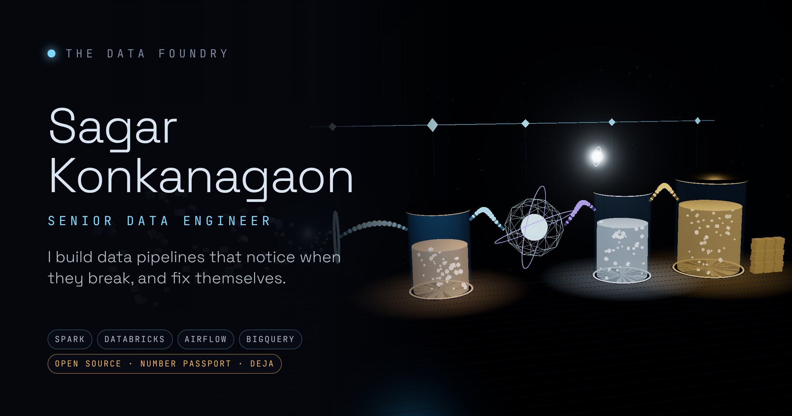

# The Data Foundry



Sagar's portfolio: a live, self-healing medallion data machine.

**Live site:** https://data-foundry-sand.vercel.app

Learning data engineering? I also run [Data Dhaba](https://datadhaba.in), with handbooks, SQL and Python labs, and a 24-week path.

```bash
npm install
npm run dev        # http://localhost:3000
```

**The pipeline:** [`/pipeline`](pipeline/) is a real medallion pipeline (PySpark + Delta Lake) over
the Wikimedia recent-changes stream. GitHub Actions runs it every hour and publishes each
run report to the [`pipeline-data`](../../tree/pipeline-data/reports) branch.

**Edit text in `/content`, not in code.** See `content/README.md` for the map of
which file drives which part of the site.

## Layout

- `content/` – all copy, as markdown with YAML frontmatter
- `lib/content.ts` – the only code that reads `/content`; typed loaders
- `app/` – Next.js App Router pages (`/` and `/modules/[slug]`)
- `components/Schematic.tsx` – SVG machine; poster frame and no-WebGL fallback
- `components/sections/` – page sections

## Build plan

1. Scaffold + content ✅
2. Static machine geometry + glass shaders ✅
3. Particle flow ✅
4. HUD + state, read from real run reports ✅
5. Chaos injection + Sentinel healing ✅
6. Scroll tour + sections (Modules, Instruments, Flight Log, Transmit) ✅
7. Ask the Engine (RAG chat) ✅
8. Real pipeline in `/pipeline`, run hourly ✅
9. Performance, mobile, accessibility ✅

## The machine (`components/machine/`)

- `MachineLoader.tsx` – detects WebGL2 / reduced motion / weak devices, lazy-loads the
  scene and cross-fades it over the SVG schematic
- `Scene.tsx` – canvas, studio lighting (Lightformers), camera rig, postprocessing
- `Glass.tsx` – shared refraction buffer + `GlassVessel` (transmission, fresnel rim, caustics)
- `Chambers.tsx`, `SparkCore.tsx`, `Plumbing.tsx`, `Orchestrator.tsx`, `Sentinel.tsx`, `Atmosphere.tsx`
- `shaders/` – custom GLSL: fresnel rim + scan band, caustics, scan beam, hologram tiles, dust, backdrop fog, glow
- `layout.ts` – world positions and palette
- `geometry.ts` – shared shapes (intake curves, rings, lattice, Gold columns) and live transforms the flow reads
- `flow/sim.ts` – the record journey as a pure function of (record, time); `flow/payload.ts` – real silver rows and rejects from the latest run report
- `Particles.tsx` – one Points draw call for every record, hover to inspect; `ShuffleArcs.tsx` – Spark shuffle arcs

## Real runs and state

- `lib/runs.ts` – fetches the run reports the pipeline publishes to the `pipeline-data`
  branch (`reports/index.json`, `reports/latest.json`) on the server, revalidated every
  5 minutes. `NEXT_PUBLIC_PIPELINE_DATA_URL` overrides the base URL (local testing).
  `app/api/runs/route.ts` serves one run's full report to the browser.
- `lib/machine/replay.ts` – replays the latest (or any chosen) run's stages on the
  machine, each lit for a time proportional to its real duration; a failed stage stays red.
- `lib/machine/incidents.ts` – turns a run's error, failed DQ checks, schema changes and
  rejects into incidents the Sentinel replays. Every word on the card comes from the report.
- `lib/machine/shape.ts` – how many records ride the machine and how many go to
  quarantine follow the latest run's landed rows and reject rate.
- `components/RunHistory.tsx` – the last 48 runs as pass/warn/fail cells; each opens the
  run's stages, row counts, quarantine reasons, DQ checks, schema changes and CI log.
- `components/Hud.tsx` – real readouts from the latest run (rows landed, rows to silver,
  quarantined, DQ checks, run time) with sparklines over the run history.
- `workers/sim.worker.ts` – moves the particles off the main thread. It is bundled by
  esbuild to `public/sim.worker.js` (`npm run worker`, run before `dev` and `build`).
- `lib/machine/store.ts` – Zustand store: DAG task states, active stages, incident.

## Chaos and the Sentinel

- `lib/machine/chaos.ts` – the incident timeline (inject → detect → diagnose → heal →
  recovered) and the `fault` / `repair` curves every reacting part reads
- `components/Chaos.tsx` – the INJECT CHAOS panel (labelled as a simulation, each drill
  links to the real code path in `/pipeline`), the incident card (real or simulated) and
  the director that ticks the clock
- Failures live in `flow/sim.ts` (`applyChaos`), `Glass.tsx`
  (rims burn amber/red), `SparkCore.tsx` (hot executor) and `Plumbing.tsx` (dead ports)
- The log lines and narration come from `content/chaos/*.md`, so the story is editable

## Scroll tour and sections

- `lib/machine/tour.ts` – camera shots for each stage; `components/Tour.tsx` turns page
  scroll into tour progress and renders a glass caption per stage. Clicking a chamber
  (`components/machine/Hitboxes.tsx`) scrolls to its caption.
- Modules dock along a spine. Each capsule has a live 3D scene
  (`components/modules/scenes.tsx`) chosen by `scene:` in its markdown. All scenes draw
  into one shared, fixed canvas through drei `<View>`, so seven scenes cost one WebGL
  context, and the canvas only mounts while the section is near the viewport.
- `components/Reveal.tsx` – scroll reveals (gauge needles, flight log entries).
- Transmit posts to `app/api/transmit/route.ts`, which emails through Resend.
  Set `RESEND_API_KEY` in Vercel (and optionally `TRANSMIT_FROM` with a verified
  sender). Without a key the form opens the visitor's mail app instead. It has a
  honeypot field and a per-IP limit of 5 messages an hour.

## Ask the Engine

Grounded: it answers only from `/content` and the pipeline's run reports, cites every
fact, and says "I don't have that" when its sources don't cover a question.

- `lib/engine/retrieve.ts` splits every file in `/content` into short passages, each
  with a label and a link to where the site shows it, and ranks them per question with
  BM25 (the site overview and `content/engine.md` are always included). `TODO-SAGAR`
  questions and editor comments are never part of it.
- `lib/engine/runs.ts` turns the latest run report and the run history into two more
  sources, so pipeline questions are answered from real runs.
- `app/api/engine/route.ts` numbers the sources, tells the model to answer only from
  them with `[n]` after each fact, or to start with the `noAnswer` line from
  `content/engine.md`. If a long answer cites nothing, the `uncited` line is appended so
  it can't pass as fact. Sources go to the browser in the `X-Engine-Sources` header and
  the console turns each `[n]` into a link (`lib/engine/cite.ts`).
- Keys stay on the server: `ANTHROPIC_API_KEY` (Claude; `ENGINE_MODEL` overrides the
  model, default `claude-opus-5-5` at low effort, 2,000-token cap), or `GEMINI_API_KEY`
  (free tier; `GEMINI_MODEL` overrides `gemini-2.5-flash`) when the Anthropic key isn't
  set. Without either, the console says it is offline and shows the contact email.
- Limits: 12 questions per IP per 10 minutes, 400 per server instance per day,
  600 characters per question. In memory, so also set a spend limit with the provider.
- `npm test` runs key-free checks: retrieval finds each case study, no source contains
  `TODO-SAGAR`, run reports become sources, and citations are parsed.

## The pipeline

The numbers on the machine come from a real PySpark + Delta pipeline in `/pipeline`
that samples Wikimedia's public recent-changes stream every hour on GitHub Actions.
See [pipeline/README.md](pipeline/README.md).

## The first screen and the plain view

- The hero is server-rendered HTML: name, title, one line, the four results and the
  Résumé, GitHub, LinkedIn and Contact buttons (`components/Intro.tsx`, text from
  `results` and `actions` in `content/site.md`). It reads without JavaScript.
- The machine loads behind it only after the page's `load` event and an idle moment,
  so it never competes with the first screen.
- Below `lg` the first screen keeps to those essentials; the run history, readouts and
  chaos drills open the next block.
- `/plain` (`app/plain/page.tsx`, text in `content/plain.md`) is the page without the
  machine: the same facts, the latest run in numbers, experience, projects and contact.
  No WebGL and no client components. "Skip the machine" links to it.

## Devices, performance and SEO

- The share image (`app/opengraph-image.tsx`, also used for X cards) is drawn from the
  latest run report: name, title, the four results, the last 48 runs and the latest
  run's numbers. It re-renders at most every few minutes.
- The banner video loads only when its band nears the screen, and never with reduced
  motion or data saver (`components/BannerVideo.tsx`).
- Web fonts use `display: optional`, so slow connections keep the fallback font
  instead of re-laying out the first screen.

- `lib/gpu.ts` picks a version of the machine per device: the full 3D machine on
  desktops with a real GPU (without post effects on modest ones), a **2.5D machine** on
  phones, with data saver and on software-rendered WebGL, and the still schematic with
  reduced motion or no WebGL. Phone visitors can tap **Load 3D**; the choice is remembered.
- `?render=3d`, `?render=2.5d` or `?render=static` forces a version, for checking each
  one on a single machine.
- The 2.5D machine (`components/machine/Machine25D.tsx`) stacks the schematic's depth
  layers in CSS 3D, runs records through the conduits, flies the same scroll tour and
  reacts to injected chaos with the Sentinel's beam. No WebGL.
- In 3D, a frame-rate governor sheds post effects, then resolution, below 45 fps, earns
  resolution back with headroom, and switches to 2.5D if the scene stays under 14 fps.
  The 3D chunk loads only once the browser is idle after first paint.
- Accessibility: skip link, visible focus rings, ordered headings, text alternatives for
  every version of the machine, and all motion off with reduced motion.
- SEO: canonical URLs, an Open Graph card (`app/opengraph-image.tsx`), `sitemap.xml`,
  `robots.txt` and JSON-LD for the profile. Set `NEXT_PUBLIC_SITE_URL` when a custom
  domain goes live; until then the Vercel production URL is used.
- Links in `content/site.md` that still point at a placeholder or at a file missing from
  `/public` (like `/resume.pdf`) are hidden until they're real.
- Lighthouse (local production build): mobile 95 performance, 100 accessibility,
  100 SEO; desktop 100 / 100 / 100. Best practices reads 96 here only because this
  sandbox blocks the Wikimedia stream.
