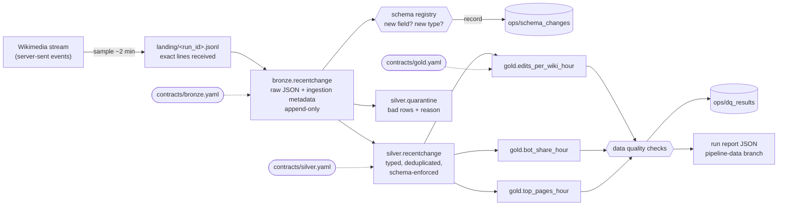

# The Data Foundry pipeline

A small, real medallion pipeline. Every hour, GitHub Actions samples the public
Wikimedia recent-changes stream (every edit on every Wikipedia), runs it through
bronze, silver and gold Delta tables with PySpark, checks the data, and publishes a run
report. The portfolio site reads those reports, so the numbers on it come from real runs.

- **Run history:** the `pipeline-data` branch, `reports/index.json` (last 30 days)
- **Latest run:** `reports/latest.json` on the same branch
- **Schedule and logs:** the `pipeline` workflow in the Actions tab

## Architecture



All three layers are partitioned by `event_hour` (UTC, `yyyy-MM-ddTHH`).

| Stage | What it does | Code |
| --- | --- | --- |
| extract | Reads the stream for a fixed window (default 120 s, at most 10,000 events) and writes the lines untouched to a landing file | `foundry/source.py` |
| bronze | Appends every line, valid or not, with `_run_id`, `_source`, `_line`, `_ingested_at` | `foundry/bronze.py` |
| schema | Compares the run's fields with the registry and records anything new | `foundry/evolution.py` |
| silver | Types and validates every row from the contract, deduplicates on `event_id`, routes rejects to quarantine | `foundry/silver.py` |
| gold | Rebuilds the three aggregate tables for the hours the run touched | `foundry/gold.py` |
| quality | Row count, null rates, uniqueness, freshness, two reconciliations, reject rate | `foundry/quality.py` |
| retention | Keeps the newest 72 hours in the lake | `foundry/lake.py` |

`foundry/run.py` runs the stages in order and times and counts each one. If a stage
raises, the run stops there, the rest are marked skipped, and the report is still
published with the error. A failed run shows up in the history like any other.

## Data contracts

One YAML file per layer in `contracts/`. The code reads them; it doesn't repeat them.

- **bronze.yaml**: the bronze columns, the minimum row count, and the fields the upstream
  schema documents (`mediawiki/recentchange` 1.0.0), which seed the schema registry.
- **silver.yaml**: each column's JSON path in the raw event, its type, whether it may be
  null and its allowed values; the dedup key; the reject-rate limit; DQ thresholds.
  Add a column here and the next run extracts it, and the Delta table gains the column.
- **gold.yaml**: the columns and types of each aggregate table.

**Fail fast.** Before a layer is written, its DataFrame must match the contract exactly
(names and types), non-nullable columns must have no nulls, and silver's reject rate must
be under `max_reject_rate` (25%). Any breach raises `ContractViolation` and nothing for
that layer or after it is written.

**Row-level problems are not violations.** A single bad row goes to
`silver.quarantine` with one reason:

| Reason | Meaning |
| --- | --- |
| `malformed_json` | The line isn't a JSON object |
| `filtered:domain` | `meta.domain` is in `drop_domains` (Wikimedia's synthetic `canary` events) |
| `null:<column>` | A required value is missing |
| `type:<column>` | The value is present but doesn't cast to the contract type |
| `domain:<column>` | The value is outside `accepted_values` |

## Data quality

Saved per run in the report and in the `ops/dq_results` Delta table.

| Check | Severity | Rule |
| --- | --- | --- |
| `row_count` | error | A live run lands at least `min_rows` rows |
| `null_rate` | error | Per column, at most the contract's `max_null_rate` |
| `unique` | error | No duplicate `event_id` in silver |
| `freshness` | warn | Newest event at most 30 minutes old (live runs only) |
| `reconciliation` bronze → silver | error | bronze rows = silver + quarantine + duplicates, with duplicates recounted from the written tables |
| `reconciliation` silver → gold | error | Gold edit totals equal silver's edit count |
| `reject_rate` | warn | Above 5% warns; above 25% the contract already failed the run |

A failed `error` check marks the run `failed`, a failed `warn` check marks it `warned`.

## Schema evolution

The stream's schema allows extra fields, and fields do appear and change. Each run:

1. Scans its events for every field path (top level, and one level into `meta`,
   `length` and `revision`) and the JSON type of each value.
2. Records a field never seen before as `added`, and a known field with a new type as
   `type_widened`, in the run report and `ops/schema_changes`. The registry is updated
   so each change is recorded once.
3. Keeps running. New top-level fields land in silver's `extras` map column, so nothing
   is lost and no code changes. A known field whose new type no longer casts goes to
   quarantine as `type:<column>`, where the report shows it.

Absent fields are not recorded as removed: many fields are optional, so a few minutes
without one says nothing about the schema.

## Idempotency, re-runs and backfills

Silver, quarantine and gold are rebuilt **per hour partition from all bronze rows in that
hour**, then written with Delta `replaceWhere` on exactly those hours. One code path
serves every case, and running any of them twice gives the same tables:

- a normal run rebuilds the hours its events fall in (late events reopen their hour)
- the same events arriving twice are deduplicated on `event_id`, earliest copy wins
- `foundry run --replay RUN_ID` loads an earlier run's landing file again; bronze sees the
  run id is already there and lands nothing
- `foundry rerun --hour H` and `foundry backfill --start H1 --end H2` rebuild hours from bronze

The tests run the same data twice, re-run an hour and backfill a range twice, and
assert every table's row count is unchanged.

## Run reports

`reports/latest.json` (full report), `reports/index.json` (one summary per run, newest
first, 30 days) and `reports/runs/YYYY-MM-DD/<run_id>.json`. A report holds:

- `status` (`passed`, `warned`, `failed`), `trigger`, start, finish and duration
- `source`: stream URL, seconds sampled, events, bytes, event-time window
- `stages`: per stage, status, duration, rows in and out
- `rows`: landed, bronze, silver, quarantine, duplicates
- `rejects`: total, rate, count per reason, up to five sample rows
- `dq`: every check with observed value and threshold
- `samples`: twelve silver rows (stable pick by hashed `event_id`) for the site's hover cards
- `schema_changes`, `contract_notes`, `gold` (edits, bot share, top wikis and pages)
- `error` (stage, type, message) when the run failed
- `code`: the commit and a link to the Actions run that produced it

## Running it

Needs Python 3.10+ and Java 17 or newer.

```bash
cd pipeline
pip install -e ".[dev]"

foundry run                                   # sample the live stream for 2 minutes
foundry run --sample-seconds 30               # shorter sample
foundry run --fixture fixtures/recentchange_sample.jsonl   # offline
foundry rerun --hour 2026-11-11T16
foundry backfill --start 2026-11-11T00 --end 2026-11-11T23

pytest                                        # 32 tests, about 2 minutes
```

`--lake` (default `./lake`) and `--reports` (default `./reports`) choose where tables
and reports go. The exit code is 1 when the run failed.

`fixtures/recentchange_sample.jsonl` is **synthetic**: 616 events generated by
`fixtures/make_fixture.py` in the shape of the upstream schema, with one deliberately
bad line for each quarantine reason and a field the contract doesn't know. It keeps the
tests offline and deterministic. The live stream is the only source in production.

## Orchestration

`.github/workflows/pipeline.yml` runs at 17 minutes past every hour, and on demand
(run, rerun or backfill). One run at a time. The Delta tables persist between runs in
the Actions cache; the run report is committed to the `pipeline-data` branch, which
Vercel is told not to deploy. `.github/workflows/pipeline-ci.yml` lints and tests every
change to this folder, plus a 20-second sample of the live stream.

## Design trade-offs

- **Spark for a few thousand rows an hour.** This volume would fit in pandas or DuckDB.
  Spark with Delta is here because it's what the patterns are for (partition overwrite,
  schema enforcement, MERGE-free idempotency), and the same code would run on a cluster.
  The cost is about a minute of JVM start-up per run.
- **Sampling, not streaming.** Two minutes an hour keeps a free GitHub runner enough.
  The gold tables therefore count the sampled window, not the whole hour, and every
  report says so. A continuous consumer (Structured Streaming on an always-on host) is
  the next step if full counts matter.
- **Rebuild the hour instead of MERGE.** Recomputing an hour from bronze is simpler to
  reason about than incremental MERGEs and makes re-runs and backfills the same thing.
  It costs re-reading the hour, which is cheap at this size and bounded by partitioning.
- **Actions cache as storage.** No cloud bucket or credentials to manage. The cache can be
  evicted (unused for 7 days, or over 10 GB), so the lake keeps only 72 hours, and each
  report says whether the lake was restored. The 30-day history lives in the reports,
  which are in git and never evicted.
- **Schema registry on the driver.** The field scan runs in Python over the landing file.
  At thousands of events that's milliseconds; at scale it would be a Spark job over a sample.
- **Reports in a git branch.** The site fetches static JSON, so there's no database or
  API to run. The branch gains a commit an hour, which is fine for a demo and would move
  to object storage in production.
- **Scheduled Actions are best effort.** GitHub can start a scheduled run late or skip it
  under load, and pauses schedules in repos with 60 days of no activity. The history
  shows gaps honestly when that happens.
